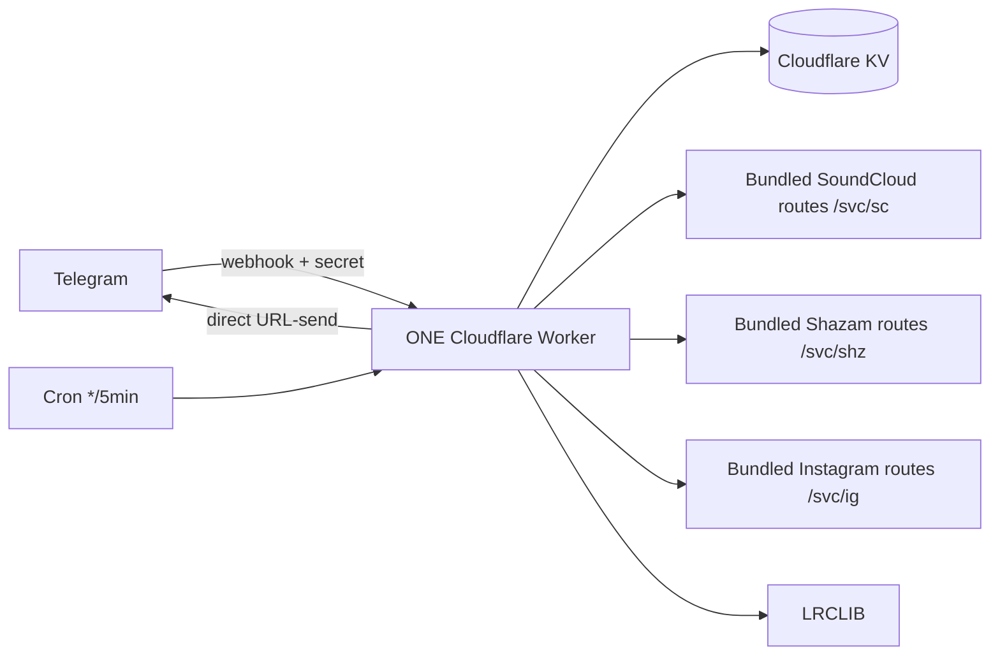

# 🎧 Music — Telegram Music Bot on Cloudflare Workers

> An always-on Telegram bot that **searches, recognizes, and downloads music**.
> Built on Cloudflare Workers + KV, backed by the owner's SoundCloud / Shazam /
> Instagram / LRCLIB services. Persian-first UI with an English option.
>
> **Creator: Ali Mousavi — [@AliMsvD](https://t.me/AliMsvD)**

---

## ✨ Features

| Area | What it does |
|---|---|
| 🔎 Smart search | Artist → top tracks; `Artist – Title` → direct delivery; ambiguous → paginated list (10/page) |
| ⬇️ Delivery | `sendAudio` upload w/ caption + artwork, **file_id cached in KV** → instant resend, auto-lyrics |
| ♾ Inline mode | `@bot <query>` in any chat → audio results via signed `/dl/` proxy |
| 🎙 Recognition | voice / audio / video → Shazam; lyrics-snippet → song |
| 📲 Instagram | reel/post → media + background music recognition button |
| 👪 Groups | `/music`, `/find` reply, `/settings`, forced-join aware |
| 👑 Panel | stats, forced-join, broadcast, ban, settings, webhook tools, CSV export, self-test |
| 🌐 i18n | Persian (default) + English, RTL-friendly |

---

## 🏗 Architecture



The repository contains the bot **and the three service workers** in one deploy:

- `src/index.js` — bot router + `/svc/*` bundled-service router
- `src/services/workers/soundcloud.js` — SoundCloud search/HLS/remux/direct-file service
- `src/services/workers/shazam.js` — Shazam recognition/search/lyrics service
- `src/services/workers/insta.js` + `src/services/workers/lib/` — Instagram resolver/download service
- `src/handlers/*` — message, callback, search, recognize, insta, inline, admin, gate
- `src/services/*` — bot adapters; when `*_API_URL` is empty they self-route to the bundled `/svc/*` routes
- `src/utils/*` — escaping, HTTP retry, KV store, crypto

Audio delivery is URL-only: the bot passes `/svc/sc/f/<sid>/...mp3` to Telegram;
the Worker does not download, buffer, or store music bytes. Telegram fetches the
validated progressive file directly.

---

## 🚀 استقرار روی Cloudflare با یک کلیک

[](https://deploy.workers.cloudflare.com/?url=https://github.com/Alimsv-d/Music)

با فشردن دکمه، Cloudflare یک کپی از مخزن در حساب کاربر می‌سازد، Worker و KV را به‌صورت خودکار راه‌اندازی و Deploy می‌کند. **فقط `BOT_TOKEN` و `OWNER_ID` لازم‌اند:**

| فیلد | از کجا؟ |
|---|---|
| `BOT_TOKEN` | توکن ربات از [@BotFather](https://t.me/BotFather) — **اجباری** |
| `OWNER_ID` | آیدی عددی پیش‌فرض سازنده (`8437014959`)؛ کاربر برای مالکیت ربات خودش آن را با آیدی خود جایگزین کند — **تنها مقدار متغیر اجباری** |

نام سازنده و username پیش‌فرض **Ali Mousavi / @AliMsvD** هستند و کاربر در صورت نیاز می‌تواند آن‌ها را در فرم Deploy تغییر دهد؛ برای اجرای معمولی نیازی به تغییرشان نیست. آدرس عمومی SoundCloud، Shazam و Instagram، KV، کلیدهای امنیتی، webhook و پایگاه‌داده/ذخیره‌سازی مورد نیاز خودکار تنظیم می‌شوند. `LEGACY_INSTA_API_URL` داخلی است و کاربر نباید آن را پر کند.

> فیلدهای `WEBHOOK_SECRET`، `LINK_SECRET` و `ADMIN_SETUP_KEY` را **خالی بگذارید** — از `BOT_TOKEN` شما مشتق امن می‌شوند. کاربر باید در Cloudflare وارد شده و مجوز اتصال به GitHub را بدهد.

**اگر Deploy Button را fork نمی‌خواهید:** می‌توانید مستقیم با Wrangler هم مستقر کنید (`npm run deploy`) و بعد فقط `/setup` را بدون کلید باز کنید — اولین بار فعال‌سازی انجام می‌شود و بعد قفل می‌شود.

### استقرار از طریق GitHub Actions (جایگزین)

Repo → **Actions → deploy → Run workflow**. جزییات ورودی‌ها در `.github/workflows/deploy.yml`.

### 4 — BotFather checklist (one-time, required)
```
/setinline            -> enable inline mode
/setinlinefeedback    -> enable (for stats)
/setprivacy           -> Disable   (so /music works in groups)
/setjoingroups        -> Enable
```
Then send `/start` to your bot. Done.

---

## 🖥 Manual / local deploy (cPanel host or Termux)

```bash
# clone from the public repository:
git clone https://github.com/Alimsv-d/Music.git

cd Music
./scripts/bootstrap.sh          # checks node, installs, .dev.vars, tests, gh secrets
# then either:
npm run deploy                  # wrangler login + creates KV + deploys
curl "<worker>/setup"           # first call activates webhook (locks afterwards)
```

`bootstrap.sh` also sets GitHub secrets for you if `gh` is authenticated.

### `.dev.vars` (local secrets — gitignored)
Copy `.dev.vars.example`, fill `BOT_TOKEN` — the other secrets are optional
(auto-derived from `BOT_TOKEN`). Never commit it.

---

## ⚙️ Env / secrets table

| Name | Kind | Purpose |
|---|---|---|
| `BOT_TOKEN` | secret | Telegram token — **the only required secret** |
| `OWNER_ID` | var | owner numeric id — default is the author; replace it only when deploying for another owner |
| `OWNER_USERNAME` / `CREATOR_NAME` | var | default `AliMsvD` / `Ali Mousavi`; optional customization |
| `WEBHOOK_SECRET` | secret (opt) | auto-derived when empty |
| `LINK_SECRET` | secret (opt) | HMAC-sign `/dl/` proxy URLs — auto-derived when empty |
| `ADMIN_SETUP_KEY` | secret (opt) | guard `/setup` re-run — auto-derived when empty |
| `SOUNDCLOUD_API_URL` / `SHAZAM_API_URL` / `INSTA_API_URL` | var | آدرس‌های عمومی آماده به‌صورت پیش‌فرض تنظیم شده‌اند؛ در صورت نیاز قابل جایگزینی‌اند |
| `LEGACY_INSTA_API_URL` | var (optional) | خالی؛ مسیر داخلی Instagram استفاده می‌شود |
| `LRCLIB_API_URL` | var | `https://lrclib.net` |
| `SHAZAM_BACKEND_URL` / `_KEY` | secret (opt) | ffmpeg backend for OGG/video recognition |
| `TELEGRAM_API_BASE` | var (opt) | override for e2e tests |
| `PUBLIC_URL` | var (opt) | worker public origin for webhook/links |

---

## 👑 Admin guide

`/panel` (private, owner/admin). Owner-only: admins, settings, tools.
- **Stats** — users/DAU, groups, searches/downloads, cache hit %, API health.
- **Forced join** — add `@chan` / `t.me/…` / `-100…` or invite link; per-channel
  toggle; global toggle in KV; `✅ عضو شدم` re-check; **fail-open** on TG errors.
- **Broadcast** — send text/media/forward → pick target → chunked ~25 msg/s via
  cron + `waitUntil`; honors `retry_after`, marks blocked inactive, live report.
- **Ban** — by id / reply / forward; reason; list.
- **Settings** — maintenance, auto-lyrics, inline, page size, rate, lang,
  welcome text, support button — all live in KV.
- **Tools** — webhook set/info/delete, self-test, clear cache, CSV export, errors.

---

## 🧪 Testing

```bash
npm test               # 49 unit tests
node scripts/e2e.mjs   # worker-level e2e (mock TG + real SC backend)
node scripts/live-check.mjs   # live backend latency check
node scripts/lint.mjs         # syntax + import resolution
node scripts/secret-scan.mjs  # before every push
```

> **Host note:** this cPanel host caps OS threads, so `wrangler dev`/`workerd`
> cannot run locally. The e2e harness runs the *real* worker code (`src/index.js`)
> directly against a stubbed Telegram + live SoundCloud — it needs no workerd.

## ⚠️ Known limits
- Telegram upload **50 MB**, `getFile` **20 MB**; large files → direct-link button.
- SoundCloud serves **m4a (audio/mp4)** — delivered as `.m4a` audio.
- OGG-Opus voice/video needs an ffmpeg backend (`SHAZAM_BACKEND_URL`) to
  fingerprint; without it the bot replies "send a clearer clip" (fail-soft).
- Free-plan Worker: 128 MB RAM, ~50 subrequests, 10 ms CPU — the code streams
  audio and batches broadcast to stay inside it.

## 🔧 Troubleshooting
| Symptom | Fix |
|---|---|
| Bot silent | `curl <worker>/health` → check `webhook.error`; re-run `/setup?key=` |
| 403 on webhook | `WEBHOOK_SECRET` must match `setWebhook` `secret_token` (Action does this) |
| Inline empty | `/setinline` + `/setprivacy Disable` in @BotFather |
| Voice not recognized | set `SHAZAM_BACKEND_URL` (ffmpeg) — see Known limits |
| Group ignores /music | `/setprivacy Disable`, re-add bot, check `/settings` enabled |

## ❓ FAQ
- **چرا GitHub Actions؟** این روش جایگزین دکمه Deploy است و برای deployهای تکراری یا کنترل‌شده کاربرد دارد؛ برای شروع سریع از دکمه نارنجی بالا استفاده کنید.
- **آیا کاربر می‌تواند خودش میزبانی کند؟** بله؛ باید حساب Cloudflare، توکن ربات تلگرام و شناسه عددی مالک خودش را وارد کند.
- **آمار دقیق است؟** تقریبی است (KV). برای دقت کامل می‌توان D1 را جایگزین کرد.

---

<div align="center">
Made with ❤️ by <b>Ali Mousavi</b> — <a href="https://t.me/AliMsvD">@AliMsvD</a><br>
Running on Cloudflare Workers · MIT License
</div>
