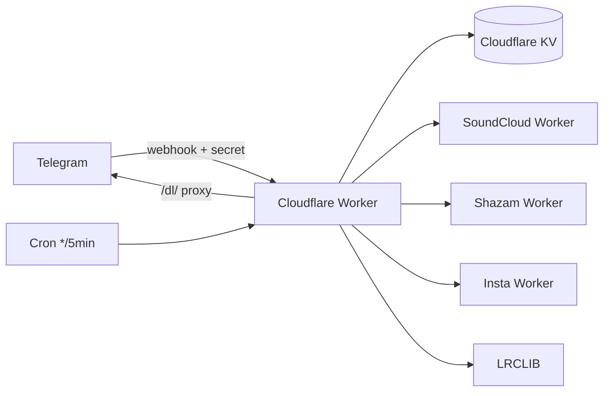

# 🎧 Music — Telegram Music Bot on Cloudflare Workers

> An always-on Telegram bot that **searches, recognizes, and downloads music**.
> Built on Cloudflare Workers + KV, backed by the owner's SoundCloud / Shazam /
> Instagram / LRCLIB services. Persian-first UI with an English option.
>
> **Creator: Ali Mousavi — [@AliMsvD](https://t.me/AliMsvD)**

---

## ✨ Features

| Area | What it does |
|---|---|
| 🔎 Smart search | Artist → top tracks; `Artist – Title` → direct delivery; ambiguous → paginated list (10/page) |
| ⬇️ Delivery | `sendAudio` upload w/ caption + artwork, **file_id cached in KV** → instant resend, auto-lyrics |
| ♾ Inline mode | `@bot <query>` in any chat → audio results via signed `/dl/` proxy |
| 🎙 Recognition | voice / audio / video → Shazam; lyrics-snippet → song |
| 📲 Instagram | reel/post → media + background music recognition button |
| 👪 Groups | `/music`, `/find` reply, `/settings`, forced-join aware |
| 👑 Panel | stats, forced-join, broadcast, ban, settings, webhook tools, CSV export, self-test |
| 🌐 i18n | Persian (default) + English, RTL-friendly |

---

## 🏗 Architecture



* `src/index.js` — router, webhook verify, `/setup` `/health` `/dl/`, cron
* `src/telegram.js` — Bot API client (429/403 handling, multipart upload)
* `src/handlers/*` — message, callback, search, recognize, insta, inline, admin, gate
* `src/services/*` — typed adapters → one `Track` shape
* `src/utils/*` — esc/normalize/fuzzy, HMAC, http retry, KV store, audio
* `src/i18n/index.js` — all user-facing strings (fa/en)

**Data model** — one KV key per entity (`u:<id>`, `chat:<id>`, `admin:<id>`,
`ch:<id>`, `cfg:<name>`, `track:<src>:<id>`, `srch:<id>` TTL, `fav:<uid>`,
`stat:<yyyymmdd>:<metric>`, `job:<id>`). Scales to millions — *no* giant JSON
array. Counters are approximate (KV isn't atomic); swap to D1 later if needed —
all access is isolated in `src/utils/kv.js`.

---

## 🚀 Deploy — private repo → GitHub Actions

> ⚠️ This repo is **private**, so the public "Deploy to Cloudflare" button does
> **not** work. Deployment is done **only** through the GitHub Action below.
> *(To enable one-click deploy later, the repo would need to be public.)*

### 1 — Create a Cloudflare API token
`dash.cloudflare.com` → **My Profile → API Tokens → Create Token → Custom**:

| Permission | Level |
|---|---|
| Workers Scripts | **Edit** |
| Workers KV Storage | **Edit** |
| Account Settings | **Read** |

Include your account. Save the token.

### 2 — Add repo secrets
Repo → **Settings → Secrets and variables → Actions → New repository secret**:

| Secret | Value |
|---|---|
| `CLOUDFLARE_API_TOKEN` | the token above |
| `CLOUDFLARE_ACCOUNT_ID` | dash → Workers → right sidebar |
| `BOT_TOKEN` | from **@BotFather** |
| `WEBHOOK_SECRET` | `openssl rand -hex 24` |
| `LINK_SECRET` | `openssl rand -hex 24` |
| `ADMIN_SETUP_KEY` | `openssl rand -hex 16` |

### 3 — Deploy
Push to `main`, or repo → **Actions → deploy → Run workflow**.

The workflow has two modes:

- `activate = false` (default): deploys and checks the Worker health only; it
  does **not** change Telegram's current webhook. Use this first for a safe
  Cloudflare smoke test.
- `activate = true`: deploys and then calls `/setup`, which registers the
  Cloudflare Worker as Telegram's webhook and replaces the current webhook.
  Choose this only for the final cutover from cPanel.

The action will: run tests → create/inject the KV namespace → upload secrets →
`wrangler deploy` → optionally call `/setup` (webhook + commands) → verify the
Worker health/webhook and print the Worker URL in the summary.

### 4 — BotFather checklist (one-time, required)
```
/setinline            -> enable inline mode
/setinlinefeedback    -> enable (for stats)
/setprivacy           -> Disable   (so /music works in groups)
/setjoingroups        -> Enable
```
Then send `/start` to your bot. Done.

---

## 🖥 Manual / local deploy (cPanel host or Termux)

```bash
# clone needs auth because the repo is private:
git clone https://<TOKEN>@github.com/Alimsv-d/Music.git   # fine-grained PAT
# or with SSH:  git clone git@github.com:Alimsv-d/Music.git

cd Music
./scripts/bootstrap.sh          # checks node, installs, .dev.vars, tests, gh secrets
# then either:
npm run deploy                  # wrangler login + creates KV + deploys
curl "<worker>/setup?key=<ADMIN_SETUP_KEY>"   # register webhook
```

`bootstrap.sh` also sets GitHub secrets for you if `gh` is authenticated.

### `.dev.vars` (local secrets — gitignored)
Copy `.dev.vars.example`, fill `BOT_TOKEN` and the three generated secrets.
Never commit it.

---

## ⚙️ Env / secrets table

| Name | Kind | Purpose |
|---|---|---|
| `BOT_TOKEN` | secret | Telegram token |
| `WEBHOOK_SECRET` | secret | verify `X-Telegram-Bot-Api-Secret-Token` |
| `LINK_SECRET` | secret | HMAC-sign `/dl/` proxy URLs |
| `ADMIN_SETUP_KEY` | secret | guard `/setup` |
| `OWNER_ID` | var | owner numeric id (`8437014959`) |
| `SOUNDCLOUD_API_URL` | var | SoundCloud worker base |
| `SHAZAM_API_URL` | var | Shazam worker base |
| `INSTA_API_URL` | var | insta-worker base |
| `LEGACY_INSTA_API_URL` | var | fallback (`catplus.ir/api/insta`) |
| `LRCLIB_API_URL` | var | `https://lrclib.net` |
| `SHAZAM_BACKEND_URL` / `_KEY` | secret (opt) | ffmpeg backend for OGG/video recognition |
| `TELEGRAM_API_BASE` | var (opt) | override for e2e tests |
| `PUBLIC_URL` | var (opt) | worker public origin for webhook/links |

---

## 👑 Admin guide

`/panel` (private, owner/admin). Owner-only: admins, settings, tools.
- **Stats** — users/DAU, groups, searches/downloads, cache hit %, API health.
- **Forced join** — add `@chan` / `t.me/…` / `-100…` or invite link; per-channel
  toggle; global toggle in KV; `✅ عضو شدم` re-check; **fail-open** on TG errors.
- **Broadcast** — send text/media/forward → pick target → chunked ~25 msg/s via
  cron + `waitUntil`; honors `retry_after`, marks blocked inactive, live report.
- **Ban** — by id / reply / forward; reason; list.
- **Settings** — maintenance, auto-lyrics, inline, page size, rate, lang,
  welcome text, support button — all live in KV.
- **Tools** — webhook set/info/delete, self-test, clear cache, CSV export, errors.

---

## 🧪 Testing

```bash
npm test               # 49 unit tests
node scripts/e2e.mjs   # worker-level e2e (mock TG + real SC backend)
node scripts/live-check.mjs   # live backend latency check
node scripts/lint.mjs         # syntax + import resolution
node scripts/secret-scan.mjs  # before every push
```

> **Host note:** this cPanel host caps OS threads, so `wrangler dev`/`workerd`
> cannot run locally. The e2e harness runs the *real* worker code (`src/index.js`)
> directly against a stubbed Telegram + live SoundCloud — it needs no workerd.

## ⚠️ Known limits
- Telegram upload **50 MB**, `getFile` **20 MB**; large files → direct-link button.
- SoundCloud serves **m4a (audio/mp4)** — delivered as `.m4a` audio.
- OGG-Opus voice/video needs an ffmpeg backend (`SHAZAM_BACKEND_URL`) to
  fingerprint; without it the bot replies "send a clearer clip" (fail-soft).
- Free-plan Worker: 128 MB RAM, ~50 subrequests, 10 ms CPU — the code streams
  audio and batches broadcast to stay inside it.

## 🔧 Troubleshooting
| Symptom | Fix |
|---|---|
| Bot silent | `curl <worker>/health` → check `webhook.error`; re-run `/setup?key=` |
| 403 on webhook | `WEBHOOK_SECRET` must match `setWebhook` `secret_token` (Action does this) |
| Inline empty | `/setinline` + `/setprivacy Disable` in @BotFather |
| Voice not recognized | set `SHAZAM_BACKEND_URL` (ffmpeg) — see Known limits |
| Group ignores /music | `/setprivacy Disable`, re-add bot, check `/settings` enabled |

## ❓ FAQ
- **Why GitHub Actions, not the deploy button?** Private repo — the button can't see it.
- **Can users self-host?** They'd need their own tokens + the backend services.
- **Stats exact?** Approximate (KV). Swap to D1 if precision needed.

---

<div align="center">
Made with ❤️ by <b>Ali Mousavi</b> — <a href="https://t.me/AliMsvD">@AliMsvD</a><br>
Running on Cloudflare Workers · MIT License
</div>
